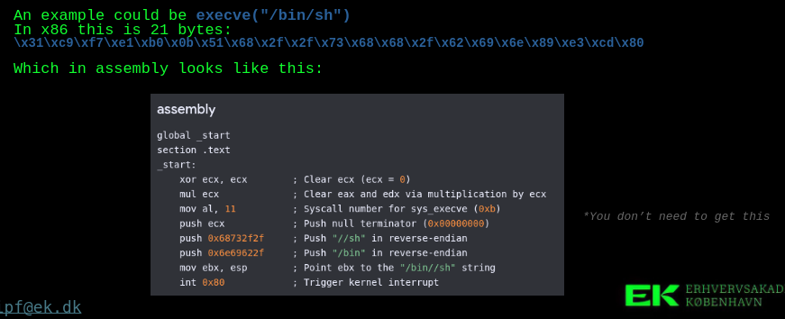
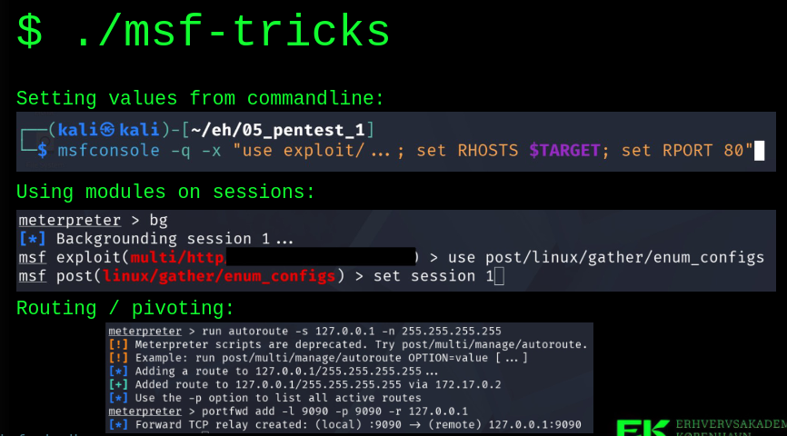

## CVE to working exploit

majority CVE dont have public exploits, and most of them are patched before disclosure.

The advisories rarely contain enough info to actually craft a working exploit, but we see exactly what is fixed.

So if you look at the dif, you can "guess" what the vulnerability is.

Patch Tuesday -> Exploit wednesday

An exploit can take months to develop depending on the complexity. Open source code is easier than closed sourced code because you the need to revesŕse engineer the process.

CVE advisory -> patch diffing -> root cause -> trigger/crash (POC level code) -> control (end of POC level code)-> reliable exploit.

### POC (proof of concept) VS. weaponized exploit

A POC is there to show a vulnerability, the bug exists. It's fragile, version limited and just cause a crash.

A weaponized exploit is:
- RELIABLE accross versions AND configs
- BYPASSES MITIGATIONS (ASLR, DEP, CFG, sandboxes [RESEARCH THIS])
- leaves the target STABLE
- and a powerful one is often STEALTHY

Most of the work and the value are in the gap between the two.
- Publishing a POC si normal disclosure practice and often required.
- Published weaponized exploits are useful for testing - but pose a societal risk.

### Payloads and shellcode

The payload is what we do wit tge control achieved with the exploit.

Shellcode is small, posiition independant amchine code. Payloads coontain shell code.

[look at beginner reverse engineer exercices]

Payloads for reverse shell, bind shell and Meterpreter -> all contai  shellcode.

Means expploit vcan be modular:
- the same exploit can deliver very different payloads
- 32bit systems need to deliver 32bit shellcode and 64bit systems need 64bit

Payloads are a LOT easier to make than a reliable exploit. There can be a trade in components.

## Exploit market

3 markets:
- white: bug bounties and vendor programs
- grey: brokers (ex. Zerodium, Crowdfense) selling to governments
- black: criminal forums

The prices reflect the target and its mitigations.
- a critical target is worth more
- a system that is harder to exploit is worth more
- an exploit that is stealthy is worth lot more

A zero-click mobile chain is worth millions.
A web app bug might not even pay a bounty.

Buyers include intelligence services, law enforcement, commercial spyware industry (NSO/Pegasus) and ransomware groups.

## Hacker mindset
### Thinking like an attacker
Hackers ask : "What does i actually do, and what else could it do?"

Every input you can think of is a question you should ask.
Ask what happens if its empty, huge, negative, Unicode or sent twice? etc.

The attack surface is built on assumptions:
- users wont do that
- this is internal
- the client already validated that

An attacker hos to find 1 gap, a defender has to cover them all which is why thinking like an attacker matters for defenders too.

### Curiosity, persistence and method
Curiosity is the essence to hacking thing. We have to pull every thread and follow the rabbit holes.
Odd error messages, version strings.. lefootvers files?

Persistence is required to succeed long term - most attemps fail, long periods of no progress and then sudden breakthrough

Being methodical will always win over relying on magic. Enumerate, hypothetize, test, take notes, repeat. Recon is most often most of the work.

READ THE DOCS, the RFC and the source! When the specs are vague, real world implementatiosn are too.

### Mindset with boundaries
The skills needed are the same on both sides.

**Authorization**, intent and what you do with a finding - is what separates you from a criminal.

Knowing **when to stop** is a skill :((( when NOT to be curious and persists - scope, consent, and the urge to click just one more.

Think in terms of **impact on real people**, not jus pwn - behind very database there are people.

The hacker ethic is built on openness and sharing knowledge - but then we run the risk of arming attackers.

## Metasploit
### TRICKS

first trick is jst a cool trick 
second trick is nice and will probably need to be used.
scenario for last trick -> from machine back to localhost. FW rules for ports on networks .. fw on hosts.. etc or docker

**docker trick**

> docker run -v /:/<volume_name> -i alpine chroot /<volume_name> sh

root in the doocker machine - not just your computer

## LOOPBACK
Loopback - ish 16 easter eggs to find
can be root on container

