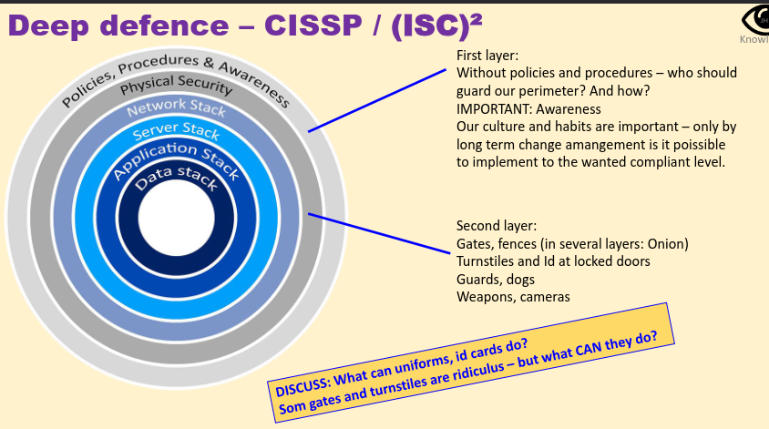
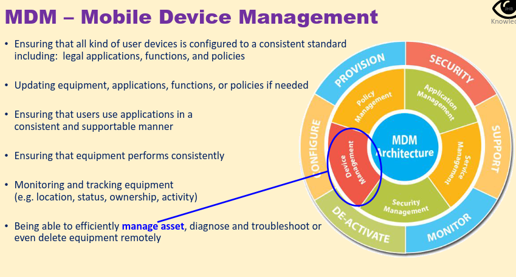

## Awareness

### Fysisk awareness
Yder perimeter er aldrig nok - angribere kommer ind alligevel hvis de er motiveret nok. Det kan være det er sværere at komme ind men vi skal stadig have styr på : at kunne opdage deep intrusion, have mitigation stratgeies, have disaster recovery strategies og en continuity plan.

#### Deep defense

Vi skal havae strategies for alle lagene, så vi stadig er sikkret selvom den ene har fejlet

#### MDM system (mobile device management)

Man skal kombinere med brugeren - hvad de har adgang til.

FE har beskyttet deres piloter ved at give dem Nokia tel - det gær det sværere for ennemies at ttarget dem personligt.

### Awareness Campaigns

### Policies - how to engage the entire organisation

Change management.come as you are

