## Attack surfaces

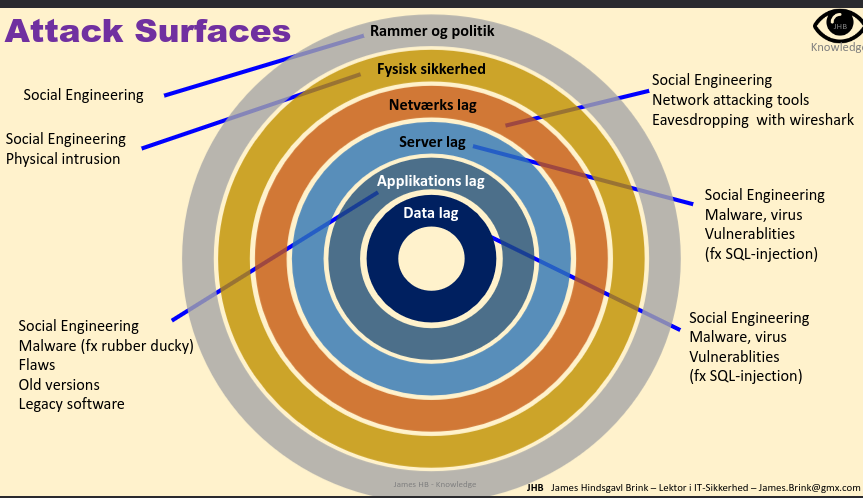

Social engennering n1 method, and then physical n2.

Flaw = code works just fine, but the design of the code is wrong, it doesnt do what the business logic needs/wants - expects.
Bug = code doesnt work to level with the busniness expectations.
Old versions = not updated, unpatched - old code that can have flaws and bugs.
Legacy = un updatable code/SW

### Network layer 

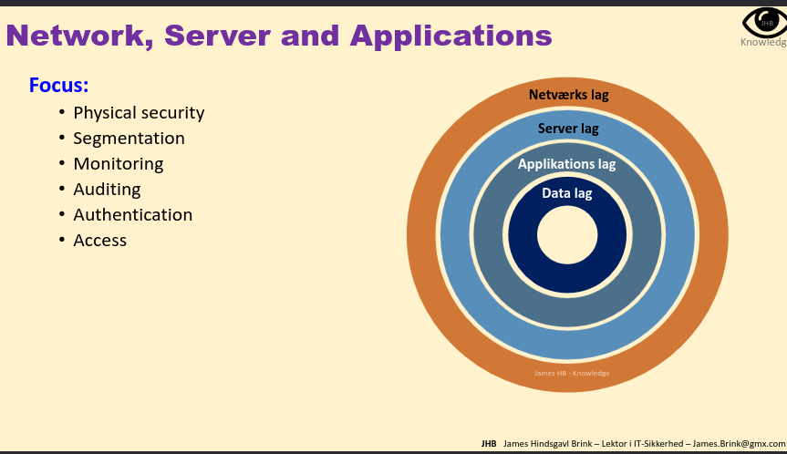

Auth is some of the harderst - we need to be able to close all gaps here - but really hard.

## How to prioritize

Identify core values - cio and ceo need to be involved.
What has the highest value, what is the asset that needs most protection etc.

FORMULES for risk assessment need to be remembered -> exam!
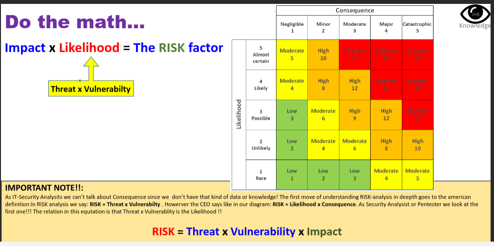

RISK FACTOR = IMPACT x LIKELIHOOD

LIKELIHOOD = THREAT x VULNERABULITY

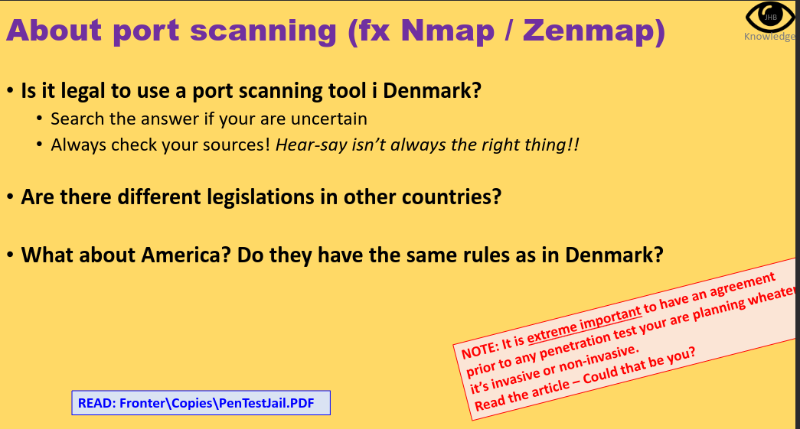

1. Not illegal but a grey zone. You are allowed when you ahve authorization or to diagnose a network ex. your own network. Active vs passive scanning - pinging or seeing iopen ports is sometimes ok, vut active vuln scanning could be interpreted as malicious.
But if you have MALICIOUS intent its illegal - how do you prove malicious intent?

Section 263 (Hacking / Unauthorized Access): It is illegal to unlawfully gain access to another person's or company's data system, or to data meant to be used in such a system. Penalties range from a fine up to 1 year and 6 months in prison (or up to 6 years for severe cases involving trade secrets or systematic/organized attacks). - DANSKE LOVE

2. Other countries and legistlations state the same thing - it is a grey zone.

3. USA too.

Remember to always have contracts and proof that you are allowed to do what you do and iin which lengths and details.

No matter how good you are, there will alwaysbe someone better - your system will be broken at some point.

## Smart alarms
Double the fence 

honey pots, phoney users fake databases .. log everything.

## Availability

Smurf attack - abuses ICMP to ping all users and spoof an ip.

## COnfidentiality + integrity

### internal fraud 
use confident security frameworks, monitoring and audit trails, segemting network

### xternal fraud

all of above + rules for combination of hardware, userids, security apps, guest systems, iip ranges.. encryption, multiple auth

OPGAVE
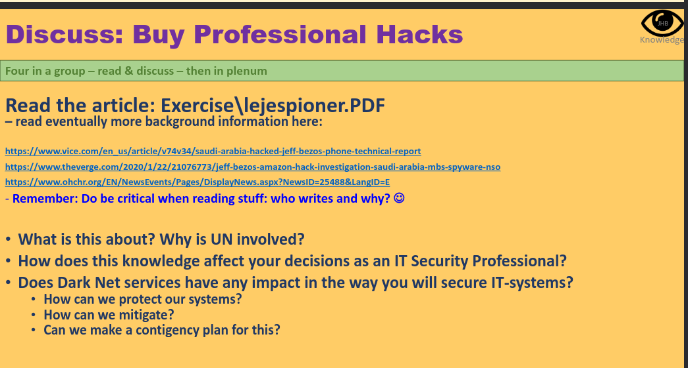

This is about countries spying on others, using hackers and hacks to get blackmail information to use for different purposes. Here it was Jeff Bezos that wa hacked and got his personal data leaked, which lead to blackmail and leaks. The UN is involved because it is cross country spying.

The making of a hack was legal adn the business buying and selling the hacks are legal . the using them is illegal. It is against the human rights to spie on an indicidual and steal their information.

It is a question of morals and ethics (and money) wheter youa s a hacker should give out a hack you have made.

# GDPR

= General Data Protection Regulation

Laws to protect private personal data.

Is a law, you get it AS IS.

## WHy do we have GDPR

Ethics, policy and law.
Was made to protect individuals. You own your own data.
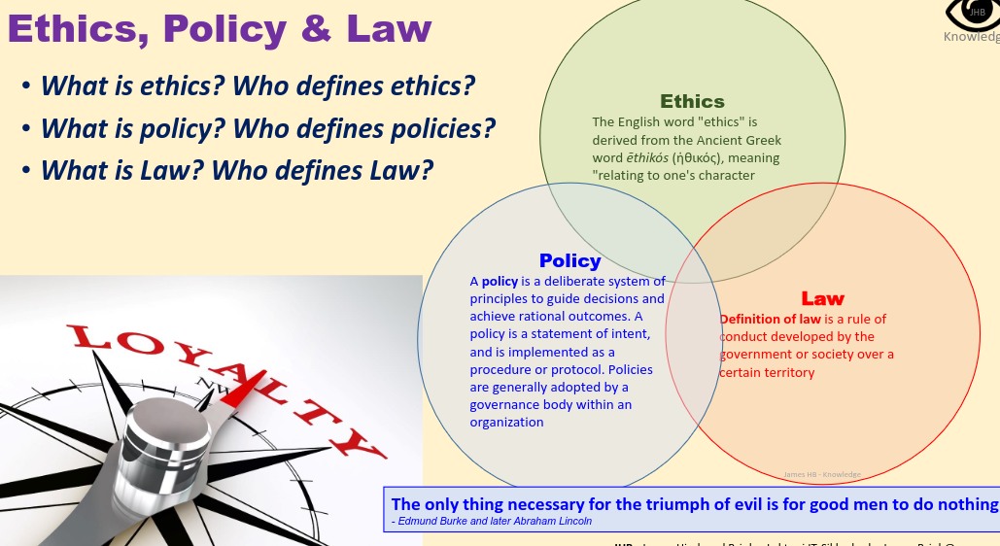

## Article 32

99 articles in all.
We have 3 actors in GDPR : the controller, processor and data subject.
A data owner, processor and subjet.

one of the points here are : 
-  the pseudonymisation and encryption of personal data.
- CIA always respected and garanteed.
- ablity to resor availability
- regular testing, assessing and evaluating of methods.

## Data processing
• Collecting
• registration
• systematization
• storage
• adaptation or change
• selection
• search
• use
• disclosure by transmission
• dissemination or any other form of transfer
• assembly or interconnection and blocking
• deletion or destruction --> Regard this carefully!!!

OPGAVE ETHICS LAWS COMPANY POLICIES
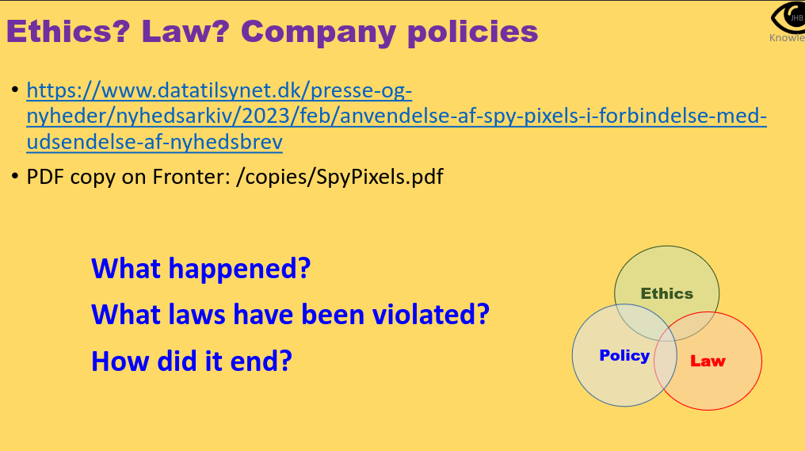

New method of moitoring and tracking people. 

classification remeber all the detais fo what to write in an asset list 

## Relavnt institutions in DK and EU
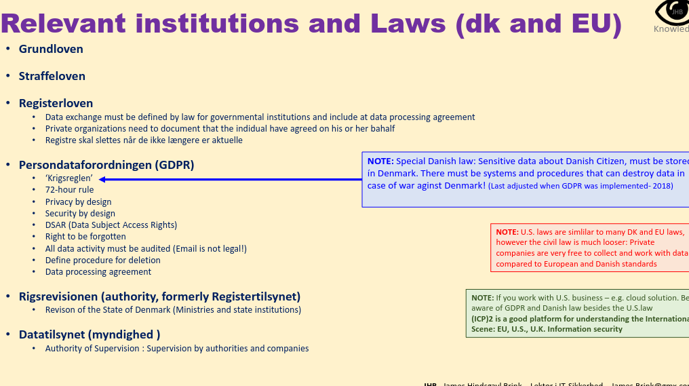

remmeber to define HOW, so fx deleting daat -> how, when, the method and details

Minimum rules to know about GDPR : THIS IS IN EXAM -- be able to explain them all in more or less details:
• ‘Krigsreglen’ : NOTE: Special Danish law: Sensitive data about Danish Citizen, must be stored
ín Denmark. There must be systems and procedures that can destroy data in
case of war aginst Denmark! (Last adjusted when GDPR was implemented- 2018)
• 72-hour rule
• Privacy by design
• Security by design
• DSAR (Data Subject Access Rights)
• Right to be forgotten
• All data activity must be audited (Email is not legal!)
• Define procedure for deletion
• Data processing agreement

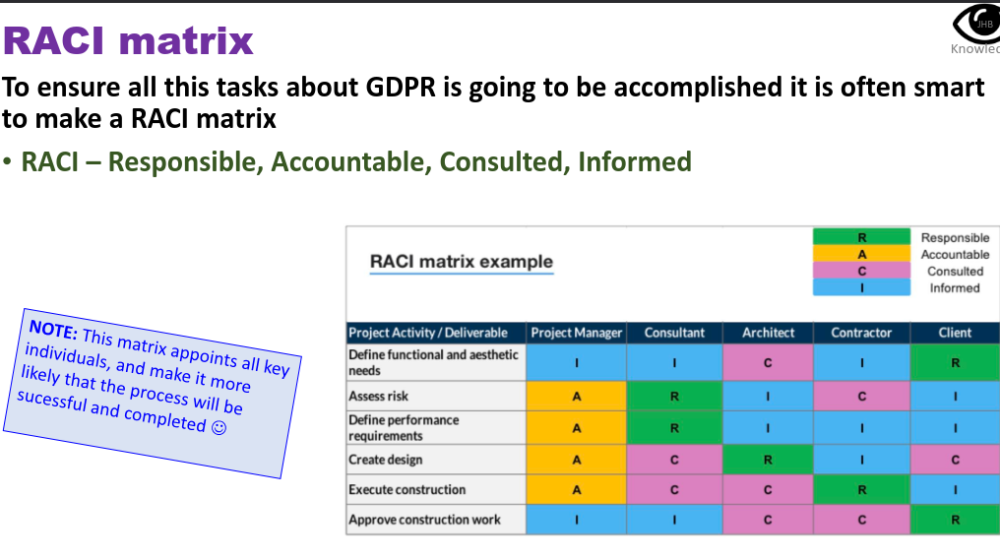
HOW TO ensure GDPR is all good and a go!!!
Responsible, Accountable, Consulted, Informed.

## GDPR and ISMS - improtant elements

- Check the controls in 27001 (SOA : status for each policy, why and why not, how it was, if it going to be etc.) adn 27002 : need to be updated with GDPR aspects too!
- impleemnt as minium the central elements form other slides here!
- MAKE RECORDS for all DBs which hold sensitive info
- Update nay data processing agreement

## RECORDS (optegnelser)

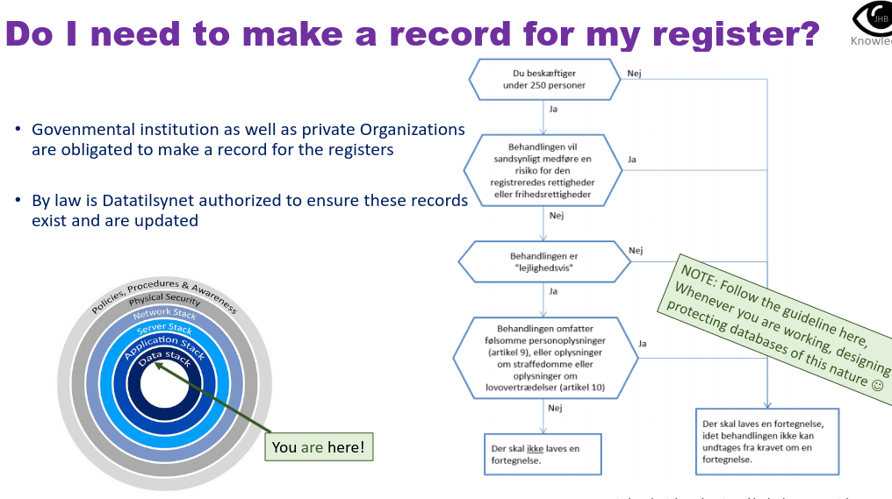

## Tech disciplines in GDPR management

• Access Rights (User Management e.g. LDAP or AD)
• Encryption
• Pseudonymisation
• Database Security
• Logging
• Backup
• Obtaining explicit consent statement for processing information
• Data minimization (optimization / minimization of data processed for execution and single process)
• Deleting data when it is no longer needed
• Compliance documentation
(the law's principle of accountability demonstrates that the data controller must be able to demonstrate compliance)
• A system handling the right to be forgotten
• Data portability

LEKTIER :

exercise gdpr.dk
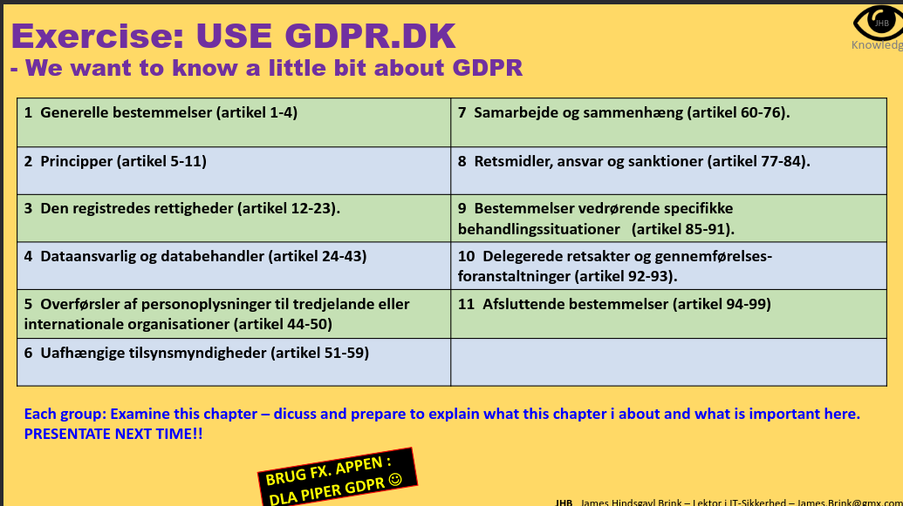
som gruppe

https://gdpr.dk/persondataforordningen/de-7-principper/

Vi står for nr 11

Vide 7 principper og 8 rettigheder til eksamen - give roverblik på hele gdpr nogenlunde - ret vigtigt!

