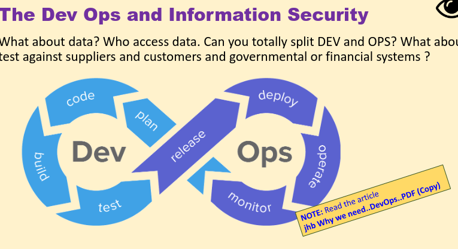
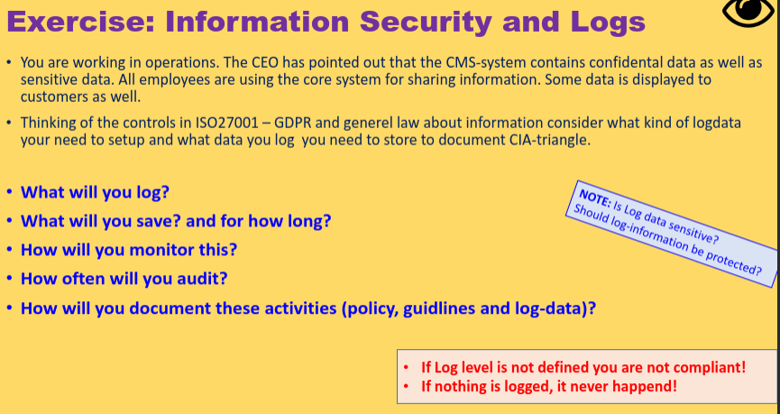
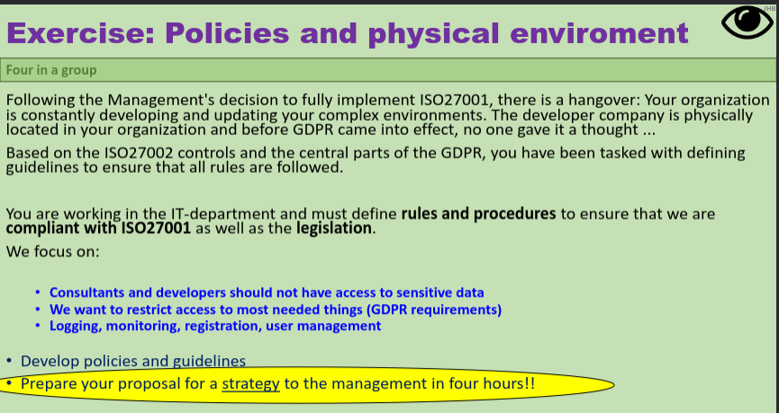
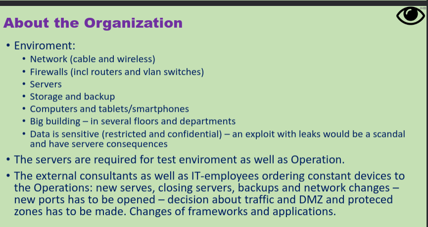

## Data behandlere aftale

You need a processor agreement prior to data exchange between orgs. or even departments.

When changin ghte use or purpose, you need a new approval from each individual.

Needs to be prepared with a lawyer.

### VS samtykke erklaring

this is for the client, the prcessor agreement is for the orgs.

Husk tilsagn (commitment) - dont need consent because it is a prerequisite for the transation to happen.

### dev ops and info sec

how? really difficult 

### Audit processes

- staff policy
- staff rules
- internal fraud
- dev ops
- hacking

### User administration

- PoLP
- iAAA - The triple A : Identification, Authentication, Authorization Accountability
- CIA triad
- ISO and GDPR

User admin (AD/LDAP)
Procedures
Rules
Logs
Revision

### Lifecycle of administration

#### lifecycle
- awareness and onboarding
- clear orders and procedures
- MUST be procedures for job rotations/role changes (crossboarding)
- MUST be procedures for closing accounts/userIDs, physical access etc (offboarding)

#### at all time
- auditing - go through ALL lists min 2-4 / year
- revisions - check random users now and again, but go through every details
- monitor traffic - must be able to see what is going on in our systems
- logging - must be able to document who reads and modifies over itme

OPGAVE

WHAT DO WE LOG?
- login / logout + fails, modified data, who accessed sensitive data + all admin actions.
CPU, server, backups
That way we can see who did what and when and see discrepencies.

WHAT DO WE SAVE? FOR HOW LONG?
All logs, until checked ??
6-12 months until auditing. Max a year.
Spørge system ejeren. hvsi de vil have 10 år, så skal vi prøve at få det til at fungere, også følge loven gdpr, etc.

HOW WE MONITOR THIS?
Set up alerts for suspect activity on sensitive data and admin actions. med SIEM.

HOW OFTEN AUDIT THIS?
2-4 / year, check all is good. Xheck in with system owner.

HOW DOCUMENT ACTIVITIES (policiy, guidelines and log data)
Make a log policy (what we log, where and when done), audit reports.
Random revisions aswell. Check against ISO and GDPR.

### Why and How do we monitor log files

a log file is a file with a standard format that get updated with data when specific event happens.
who did what when - info about the system.

we log : 
- **system logs** (dev and ops) **A** in triad. Speed, uptime, number of users etc
- **app logs** (docu, legislation, forensics) **CI** in triad. logon(/logoff, acces and rights, read and write commands on db mails etc)
- **security logs** (monitoring and forensics) **CIA** in triad. intrusion detection, traffic on FW and routers, Chnages in settings for loglevel, change in config of servers or FW rules.

remember to check in with system owner/users.
keep them from (system logs) shortest time to (security) longest possible time.

### Log flies and GDPR and ISO27001
froensics and investigation related to gdpr and security is completely depending on out LOGGING level!
ONLY way to ensure and docuemnt our CIA is intact IF system has been exploited.

As Info Sec Officer, you need to require and define logging info that are different from ordinary ops or dev logdata.

What we dont log, can be the way on for a hacker.

### REALTIME monitoring

defined by rules and settings and any incident that trigger an alarm -> red dot onmonitor / email to CISO.
MITIGATION! false negatives etc

takes times to calibrate and work in porgress, always needs adjustements.

en strategi ikke al for mange detaljer.
en 4 timers opgave, bør ikke tage mere end det.
first meeting, ideer, hvad skal der til.